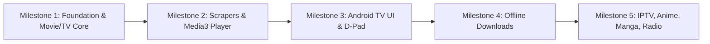

# Rive Native Android & Android TV Application Specification

## 1. Project Overview & Scope
A 100% native Kotlin application delivering the complete media catalog of **[rivestream.ru](https://rivestream.ru/)** across **Mobile, Tablet, and Android TV / Google TV** devices. The app reverse-engineers the underlying APIs and stream scrapers rather than wrapping a WebView, offering superior performance, native D-pad navigation, hardware-accelerated video decoding, and offline playback.

---

## 2. Platform & Device Support
- **Mobile & Tablet:** Touch-friendly UI with responsive layouts, gesture controls for video scrubbing/brightness/volume, and Picture-in-Picture (PiP).
- **Android TV / Google TV:** 10-foot UI designed with D-pad focus management, remote control shortcuts, and `androidx.tv.material3` components.
- **Minimum SDK:** Android 8.0 (API 26).
- **Target SDK:** Android 15 (API 35).

---

## 3. Tech Stack & Architecture

### Core Stack
- **Language:** Kotlin (100% Coroutines & Flow)
- **UI Toolkit:** Jetpack Compose & Jetpack Compose for TV (`androidx.tv:tv-material`)
- **Navigation:** Navigation Compose with adaptive layouts (`NavigationSuiteScaffold` / Bottom Bar on Mobile, Navigation Rail / Drawer on TV and Tablet)
- **Dependency Injection:** Hilt / Dagger
- **Networking:** Retrofit + OkHttp with custom Interceptors (User-Agent spoofing, Referer header injection, Cloudflare / anti-bot header handling)
- **Media Playback:** AndroidX Media3 (`androidx.media3:media3-exoplayer`, `media3-ui`, `media3-session`)
- **Background Tasks & Downloads:** Media3 `DownloadService` + Android Jetpack `WorkManager`
- **Local Persistence:** Room Database (SQLite) + Jetpack DataStore (Preferences)
- **Image Loading:** Coil Compose with disk and memory cache

### Multi-Module Clean Architecture
```text
rive-android/
├── app/                      # Application entry point, Hilt setup, manifests
├── core/
│   ├── common/               # Dispatchers, network result helpers, extensions
│   ├── database/             # Room DB, entities (Watchlist, History, Bookmarks)
│   ├── datastore/            # User settings, selected theme, custom TMDB API key
│   ├── designsystem/         # Colors, typography, Rive themes (Obsidian, Midnight, etc.)
│   ├── model/                # Domain models (MediaItem, StreamSource, Episode, Chapter)
│   └── network/              # Retrofit clients, OkHttpClient, header interceptors
├── feature/
│   ├── movies/               # TMDB movie browsing, categories, detail screens
│   ├── tvshows/              # TMDB TV series browsing, season/episode selector
│   ├── player/               # Media3 ExoPlayer screen (Mobile gestures & TV D-pad controls)
│   ├── iptv/                 # Live TV / IPTV player & channel guide
│   ├── anime/                # Anime catalog & episode browser
│   ├── manga/                # Manga reader with vertical & horizontal paging
│   ├── radio/                # Background audio radio player with notification media controls
│   └── settings/             # Theme selector, TMDB API key config, extractor updates
└── extractor/
    ├── api/                  # Base extractor interfaces & stream resolver contracts
    ├── dynamic/              # Dynamic remote manifest config (endpoints, regex, headers)
    └── providers/            # Core scrapers (VidSrc, MultiEmbed, Filmku, Valhalla, etc.)
```

---

## 4. Media Playback & Stream Extractor Architecture

### 4.1 Native Media3 / ExoPlayer Engine
- Direct hardware decoding for HLS (`.m3u8`), DASH (`.mpd`), and progressive MP4.
- Embedded subtitle rendering (WebVTT, SRT) with styling and custom language selection.
- Multi-audio track selection (switching dubbed / original audio tracks).
- Seamless playback resume (tracks playback progress down to the second in local Room DB).
- Picture-in-Picture (PiP) on mobile devices and background audio mode.

### 4.2 Modular Dynamic Extractors
- **Core Kotlin Scrapers:** Built-in parsers for primary embed providers (`vidsrc`, `multiembed`, `valhallastream`, etc.).
- **Dynamic Configuration Manifest:** Remote JSON configuration hosted on GitHub / CDN containing updated domains, regex patterns, decryption algorithms, and header rules. This allows fixing broken scrapers instantly without releasing new APK versions.

---

## 5. Data Persistence & Authentication (Local-First)
- **No Mandatory Login:** Instant, zero-friction access upon first install.
- **Room Database Entities:**
  - `WatchHistoryEntity`: Last played position, completion percentage, timestamp, season/episode info.
  - `BookmarkEntity`: Favorited movies, shows, anime, and manga.
  - `DownloadedMediaEntity`: Metadata and local file paths for offline media.
- **Preferences DataStore:**
  - Active visual theme preset.
  - Custom user TMDB API key (with default fallback embedded).
  - Video player defaults (default resolution, preferred subtitle language, auto-play next episode).

---

## 6. UI & Theming Strategy
- **Cinematic Rive Presets:** Full fidelity recreation of Rive's color schemes:
  - *Obsidian Luxury* (Deep black / gold accents)
  - *Midnight* (Deep navy blue / cool cyan accents)
  - *Charcoal / Dark* (Neutral dark graphite)
  - *Aurora* (Deep purple / emerald accents)
- **Adaptive Navigation:**
  - Mobile: Bottom navigation bar (`Movies`, `TV`, `Anime`, `Live`, `Library`).
  - Tablet & Foldable: Collapsible side navigation rail.
  - Android TV: Left-hand navigation drawer with focus-aware D-pad highlight states.

---

## 7. Implementation Roadmap



1. **Milestone 1 — Project Foundation & TMDB Catalog:**
   - Gradle project scaffolding with Hilt, Room, Compose, and Compose for TV.
   - TMDB API client integration (Trending, Popular, Search, Movie/TV Details, Seasons/Episodes).
   - Theme system with Rive presets and navigation shell.
2. **Milestone 2 — Stream Resolvers & Native Media3 Player:**
   - Implement core extractors and dynamic config parser.
   - Compose Video Player (touch gesture controls on mobile, PiP, subtitle track selector).
   - Watch history saving and resuming via Room DB.
3. **Milestone 3 — Android TV / Google TV Optimization:**
   - Implement `androidx.tv` catalog grids, hero carousel banner, and D-pad remote controls for player.
4. **Milestone 4 — Offline Download Manager:**
   - Media3 `DownloadService` and `WorkManager` for background downloading with progress notifications.
5. **Milestone 5 — Full Catalog Expansion:**
   - Add IPTV / Live Sports streams (`streamed.pk`, m3u8 playlists).
   - Add Anime & Manga (Consumet & MangaDex integration).
   - Add Radio streaming player with lock screen media controls.

